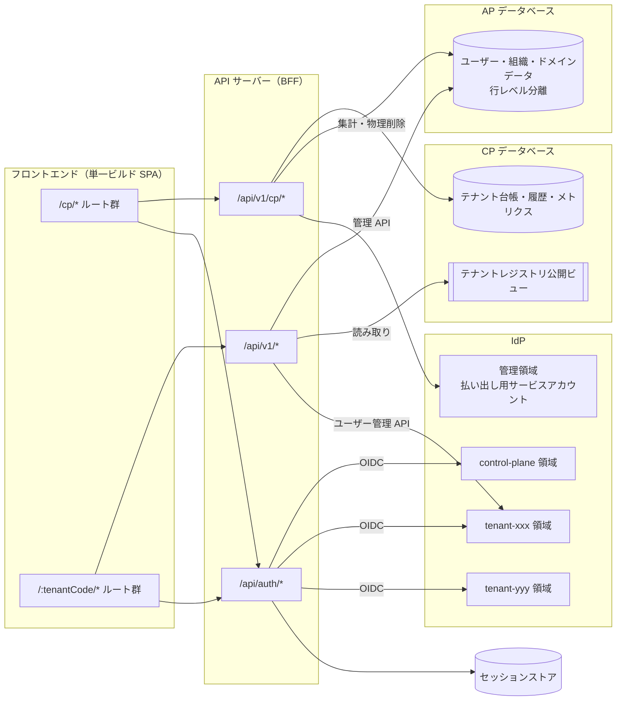
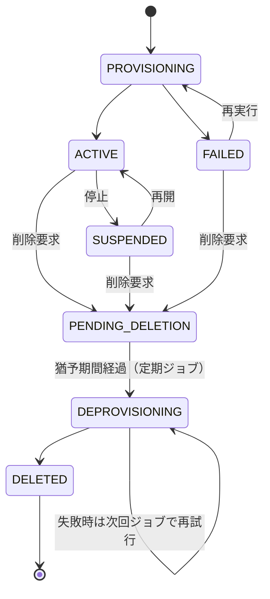
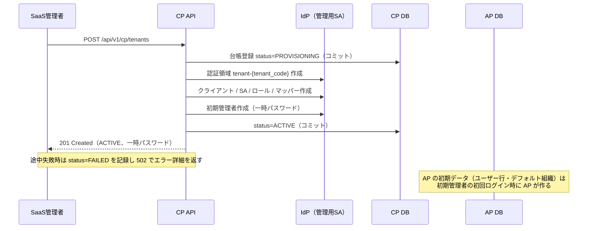

# 01. 共通基盤仕様（技術非依存）

> ステータス: ドラフト v0.5（ToDoApp.md v0.4 から共通部分を分離）
>
> 本書では製品名・フレームワーク名を使わない。具体的な実現方法は [02-platform-implementation.md](02-platform-implementation.md) を参照。

---

## 1. 目的

マルチテナント SaaS の主要な設計要素を、テーマに依存しない共通基盤として定める。

- **コントロールプレーン** と **アプリケーションプレーン** の分離
- テナントの **オンボーディング（払い出し）** と **アイデンティティ** の統合
- **テナントコンテキスト** の伝搬と **テナント分離**
- テナント横断の **利用状況の可視化（メトリクス）**

個別テーマ（例: ToDo）は、本書の 13 章「テーマが定義すべき事項」だけを追加で定義する。

---

## 2. 用語

| 用語 | 定義 |
| --- | --- |
| テナント | サービスを契約する組織単位。1 テナント = 1 アイデンティティ境界（IdP 上の独立した認証領域） |
| コントロールプレーン (CP) | テナント横断で SaaS を運用・管理する機能群 |
| アプリケーションプレーン (AP) | テナントのユーザーが利用する機能群（テーマの本体） |
| SaaS 管理者 | CP を操作する運用者（`saas_admin` ロール） |
| SaaS 閲覧者 | CP を参照のみできる運用者（`saas_viewer` ロール） |
| テナント管理者 | テナント内のユーザー・組織を管理するユーザー（`tenant_admin` ロール） |
| メンバー | テナント内の一般ユーザー（`member` ロール） |
| 組織（Organization） | テナント内の部署・チーム等のグループ。閲覧範囲制御の単位 |
| テナントID（`tenant_id`） | テナントを一意に識別する内部 ID（UUID）。データの外部キー、認証情報のカスタム属性で使用する。URL には出さない |
| テナントコード（`tenant_code`） | テナントを人が識別する英小文字の文字列。URL（`/{tenant_code}`）と認証領域名で使用する。一度払い出したら変更・再利用しない |
| テナントコンテキスト | 処理中のリクエストがどのテナントに属するかを示す情報（`tenant_id`, `tenant_code`, `user_id`, `plane`） |
| テナントレジストリ | テナントの識別子・状態を保持する CP の台帳。AP は読み取り専用の公開ビューだけを参照する |
| BFF | Backend for Frontend。ブラウザの代わりにサーバーが IdP とトークンをやり取りし、ブラウザにはセッション Cookie だけを渡す方式 |

---

## 3. スコープ

### 3.1 基盤が提供するもの

| 区分 | 内容 |
| --- | --- |
| CP | テナントの払い出し・停止・再開・削除、テナント一覧・詳細、利用状況（メトリクス）の収集・表示、CP 監査ログ |
| AP 共通 | ログイン・ログアウト、テナント内ユーザー管理、組織管理、プロフィール、AP 監査ログ |
| 認証・認可 | テナント毎の認証領域、CP 専用の認証領域、BFF によるセッション管理、ロールによる認可 |
| 横断 | テナントコンテキストの伝搬、データのテナント分離、構造化ログ・利用記録、定期実行、共通規約 |

### 3.2 対象外（初期フェーズ）

- 課金・請求
- テナント毎のデータストア / 実行環境の分離（サイロモデル）の実装
- ティアリング（プラン別機能制限・スロットリング）の本格実装
- 本番向けの HA 構成、マルチリージョン
- システム監視の実装（観点は [04-observability.md](04-observability.md) で定める）

---

## 4. アーキテクチャ原則

### 4.1 デプロイモデル

- **プール型**: 全テナントでアプリケーションの実行環境とデータストアを共有する
- ただし **CP と AP はデータストア（データベース）を分ける**。実行プロセスは当面共有してよい

### 4.2 プレーン分離

CP と AP は以下をすべて分離し、将来は別サービスとして切り出せる境界を保つ。

| 観点 | 分離の内容 |
| --- | --- |
| コード | パッケージを分け、AP は CP のコードを参照しない（逆も同様）。共有は共通部品のみ |
| URL | API のプレフィックスとフロントのルートを分ける |
| 認証 | 認証領域・クライアント・セッション・認可処理を分ける |
| データ | **データベースを分ける**。接続に使う DB ロールもプレーン毎・用途毎に分ける |

### 4.3 プレーン間で許可する依存

プレーンをまたぐ参照は次の 2 つに限定し、それぞれ専用の資格情報で行う。これ以外の依存は作らない。

| # | 方向 | 内容 | 制約 |
| --- | --- | --- | --- |
| 1 | AP → CP | テナントレジストリの参照（有効テナントの判定） | 公開ビューの**読み取りのみ**。テーブルは直接読まない |
| 2 | CP → AP | メトリクスの集計、テナントデータの物理削除 | 参照と削除のみ。**テナントコンテキストを設定して**操作し、行レベルのテナント分離を迂回しない |

将来は #1 を CP の API またはイベント、#2 を AP が発行する利用イベントに置き換える。そのため、これらの処理はリポジトリ層に閉じ込める。

### 4.4 論理構成図



---

## 5. テナント識別

### 5.1 識別子

- 内部 ID は `tenant_id`（UUID）、URL と認証領域名は `tenant_code` とし、用語を区別する
- `tenant_code` の形式: `^[a-z0-9](?:[a-z0-9]|-(?=[a-z0-9])){2,31}$`
  - 3〜32 文字、英小文字・数字・ハイフン
  - 先頭・末尾のハイフン、連続ハイフンは不可
  - ドットを含まないため、`favicon.ico` などのファイル名とは衝突しない
- `tenant_code` は一意・変更不可・**再利用しない**（削除済みテナントのコードも使えない）

### 5.2 予約語

URL の第 1 セグメントが予約語の場合はテナントとして解釈しない。テナント作成時もこれらを拒否する。

```
cp, api, auth, login, logout, callback, dev-login, link,
assets, static, public, health, admin, keycloak,
www, app, docs, help, support, status, signup, settings
```

- 予約語リストはフロント・バックで共有する定数として 1 箇所で管理する（[02](02-platform-implementation.md) 参照）
- 予約語を追加する場合、既存テナントと衝突しないことを確認する

### 5.3 テナントの特定方法

| 層 | 方法 |
| --- | --- |
| フロントエンド | URL パス `/{tenant_code}` |
| API | **セッション（= 認証結果）のみ**から導出する。API のパスにはテナントを含めない |

- API はリクエストボディ・クエリ・ヘッダーの `tenant_id` を**信用しない**
- フロントは「URL のテナントコード」と「ログイン中セッションのテナント」が一致することをルートガードで確認する

---

## 6. テナントライフサイクル

### 6.1 状態遷移



| 状態 | AP の利用 | 認証領域 | データ |
| --- | --- | --- | --- |
| PROVISIONING | 不可 | 作成中 | 作成中 |
| ACTIVE | 可 | 有効 | 保持 |
| FAILED | 不可 | 一部作成済みの可能性 | 一部作成済みの可能性 |
| SUSPENDED | 不可（403） | 無効化 | 保持 |
| PENDING_DELETION | 不可（403） | 無効化 | 保持（猶予期間 30 日） |
| DEPROVISIONING | 不可 | 削除中 | 削除中 |
| DELETED | 不可 | 削除済み | 削除済み（台帳の行は残す） |

### 6.2 オンボーディング（払い出し）

| ID | 要件 |
| --- | --- |
| CP-ONB-01 | SaaS 管理者はテナント名、テナントコード、初期管理者メールを入力してテナントを作成できる |
| CP-ONB-02 | テナントコードは 5.1 の形式に従い、5.2 の予約語は使用不可とする |
| CP-ONB-03 | 払い出しは以下のステップを順に実行し、各ステップの結果を払い出し履歴に記録する |
| CP-ONB-04 | 途中失敗時はステータス `FAILED` とし、再実行できる。**各ステップは冪等**（存在すれば検証・更新、無ければ作成）とする |
| CP-ONB-05 | 払い出しは **API リクエスト内で同期実行**し、完了（ACTIVE）または失敗（FAILED）をレスポンスで返す |
| CP-ONB-06 | 外部呼び出しには個別のタイムアウトを設定し、全体が目安 30 秒以内に終わるようにする。API サーバー・リバースプロキシのタイムアウトはこれより長く設定する |
| CP-ONB-07 | 同一テナントコードへの払い出しの同時実行を防ぐ（一意制約 + 行ロック） |
| CP-ONB-08 | `PROVISIONING` の記録は、外部呼び出しの**前に独立したトランザクションでコミット**する（失敗時に記録ごと消えないようにする）。以降の各ステップの結果も都度コミットする |
| CP-ONB-09 | 一定時間（目安 10 分）以上 `PROVISIONING` のままの払い出しは、プロセス停止等で中断したとみなし、定期ジョブで `FAILED` に遷移させる |
| CP-ONB-10 | 初期管理者の一時パスワードはレスポンスで一度だけ返す。**どこにも保存せず、ログ・監査ログ・払い出し履歴のエラー情報にも含めない** |

払い出しステップ:

| # | ステップ | 対象 |
| --- | --- | --- |
| 1 | テナント台帳に登録（`PROVISIONING`） | CP DB |
| 2 | 認証領域 `tenant-{tenant_code}` を作成 | IdP |
| 3 | ログイン用クライアント、ユーザー管理用サービスアカウント、ロール、属性マッパーを作成 | IdP |
| 4 | 初期管理者ユーザーを作成（一時パスワード、初回ログイン時に変更必須） | IdP |
| 5 | （AP の初期データ: 初期管理者のユーザー行、デフォルト組織。**CP は作らない**。下記の注記） | — |
| 6 | （テーマ固有の初期データ: 13 章の拡張点。**CP は作らない**。下記の注記） | — |
| 7 | ステータスを `ACTIVE` にする | CP DB |

**AP の初期データ（ステップ 5・6）は AP がログイン完了時に作る。** CP から AP に書き込まず、4.3 の CP → AP の依存を
「集計・物理削除」の 2 つに保つ（CP エージェントのロールに挿入・更新の権限を与えない）。

- 初期管理者のユーザー行は、初回ログイン時の同期（PF-USR-04）で作られる
- デフォルト組織（PF-ORG-04）は、ログイン完了時に「そのテナントに組織が 1 件も無い（論理削除済みを含む）」場合に作る。
  論理削除済みを含めて判定するため、テナント管理者が全組織を削除しても再作成しない
- テーマ固有の初期データ（13 章 #4）も、同じくログイン完了時に AP が作る（必要な場合。冪等にする）
- 払い出し直後（初回ログイン前）の AP DB にはテナントの行が無い。CP のメトリクスのユーザー数はログイン済みのユーザーと AP で作成したユーザーを数える



### 6.3 運用

| ID | 要件 |
| --- | --- |
| CP-OPS-01 | テナント一覧（名前、テナントコード、ステータス、作成日、ユーザー数、テーマ固有の主要指標）を表示できる |
| CP-OPS-02 | テナント詳細（払い出し履歴、メトリクス推移）を表示できる |
| CP-OPS-03 | テナントを停止できる（認証領域の無効化 + AP API で 403） |
| CP-OPS-04 | テナントを再開できる |
| CP-OPS-05 | テナントの削除を要求できる。`PENDING_DELETION` とし、認証領域を無効化して AP API を 403 にする |
| CP-OPS-06 | 削除は `ACTIVE` / `SUSPENDED` / `FAILED` のいずれからでも要求できる |
| CP-OPS-07 | 猶予期間（**30 日**）中はデータを保持する。復元 API は現時点では提供しない（将来拡張） |
| CP-OPS-08 | 猶予期間経過後、定期ジョブが認証領域とテナントデータを物理削除し `DELETED` とする。各削除処理は「既に無ければスキップ」とし冪等にする。失敗時は `DEPROVISIONING` のまま次回ジョブで再試行する |
| CP-OPS-09 | テナントコードは再利用しない。`DELETED` 後も台帳の行は残し、一意制約を維持する |
| CP-OPS-10 | 停止・削除要求は、発行済みのセッションにも**レジストリのキャッシュ期間（目安 30 秒）以内**に反映される |

### 6.4 メトリクス（利用状況）

| ID | 要件 |
| --- | --- |
| CP-MET-01 | テナント毎のユーザー数（総数・有効数）を取得できる |
| CP-MET-02 | テナント毎のテーマ固有指標（13 章で定義）を取得できる |
| CP-MET-03 | アクティブユーザーの算出元として、AP API の利用記録を構造化ログに出力する（[03](03-conventions.md) 参照）。本フェーズでは集計・表示は行わない |
| CP-MET-04 | 全テナント合計のサマリーをダッシュボード表示できる |
| CP-MET-05 | メトリクスは定期ジョブで日次スナップショットとして CP DB に保存し、推移を表示できる |

**取得方式（初期）**: 4.3 の #2 に従い、CP が AP DB をテナント毎にコンテキストを切り替えて集計する。
**将来**: AP が利用イベントを発行し、CP がイベントを取り込む方式へ移行する。集計処理はリポジトリ層に閉じ込める。

---

## 7. 認証・認可

### 7.1 認証領域（IdP）

| 認証領域 | 用途 | クライアント |
| --- | --- | --- |
| `control-plane` | SaaS 管理者のログイン | CP 用 BFF クライアント（confidential） |
| `tenant-{tenant_code}` | 各テナントのユーザーのログイン | AP 用 BFF クライアント（confidential）、ユーザー管理用サービスアカウント |
| 管理領域 | 認証領域の作成等の管理操作。UI ログインには使わない | 払い出し用サービスアカウント |

- **人の認証** と **システムの操作** を分ける
  - 人: SaaS 管理者は `control-plane`、テナントユーザーは `tenant-{tenant_code}` でログインする
  - システム: CP は払い出し用サービスアカウントで認証領域を作成・削除する。AP はテナント毎のユーザー管理用サービスアカウントでユーザーを作成・無効化する
- AP は払い出し用サービスアカウントを**使わない**（権限が大きすぎ、プレーン分離にも反するため）
- テナント管理者に IdP の管理権限は与えない（テナント識別用の属性を改ざんさせないため）
- クライアントシークレットは**保存せず導出する**。基盤のシード値と「認証領域名・クライアント ID」から決定的に生成し、払い出し時に設定する。シード値の変更でまとめてローテーションできる

### 7.2 BFF とセッション

- ブラウザはトークンを保持しない。API サーバーが BFF として認可コードフロー（PKCE 併用）を実行し、トークンはサーバー側のセッションストアに保存する。ブラウザには HttpOnly のセッション Cookie だけを渡す
- セッションは**プレーン毎に分ける**（Cookie 名・セッションストアのキー空間を分離）。同一ブラウザで CP と AP に同時ログインしても混在しない
- **AP のセッションはブラウザあたり 1 テナント**とする。別テナントの URL を開いた場合、フロントは「別テナントでログイン中」画面を出し、ログアウトしてから切り替える（複数テナントの同時ログインは将来検討）
- ログイン開始時は `tenant_code` を受け取り、テナントレジストリで **ACTIVE なテナントの認証領域に解決**してからリダイレクトする。認証領域名を直接受け取らない（管理領域や他プレーンの認証領域へのログイン開始を防ぐ）
- アクセストークンの更新はサーバー側で行う

### 7.3 CSRF 対策

Cookie によるセッションのため、CSRF 対策を必須とする。

- セッション Cookie は `HttpOnly`、`SameSite=Lax`、本番は `Secure`
- 変更系メソッド（POST / PUT / PATCH / DELETE）は、カスタムヘッダー（[03](03-conventions.md) で規定）の付与と `Origin` ヘッダーの一致を必須とする。同一オリジン構成で CORS を許可しないため、他オリジンからはカスタムヘッダーを付けたリクエストを送れない
- 認可リクエストの `state` / `nonce` / PKCE を検証する

### 7.4 認証結果の検証

AP のログイン完了時（およびトークン更新時）:

- トークンの発行元（認証領域）がテナントレジストリに**登録済みかつ ACTIVE** であること（許可リスト方式）
- トークンの対象（audience / authorized party）が AP 用クライアントであること
- トークンの `tenant_id` 属性と、発行元の認証領域に対応するレジストリ上の `tenant_id` が一致すること

AP の各リクエスト時:

- セッションのテナントが ACTIVE であること（停止・削除要求中は 403）
- セッションのプレーンが AP であること

CP:

- 発行元が `control-plane` であること
- ロール `saas_admin` または `saas_viewer` を持つこと
- `saas_viewer` は参照系（GET）のみ許可し、変更系は 403

共通:

- **AP のセッションで CP API、CP のセッションで AP API は、いずれも拒否**する

### 7.5 ロール

**CP**

| 操作 | saas_admin | saas_viewer |
| --- | --- | --- |
| テナント一覧・詳細・メトリクスの参照 | ○ | ○ |
| テナントの作成・再実行・停止・再開・削除 | ○ | × |

**AP（基盤の共通部分）**

| 操作 | tenant_admin | member |
| --- | --- | --- |
| 自分のプロフィールの参照 | ○ | ○ |
| テナント内ユーザーの一覧参照 | ○ | ○ |
| 組織の一覧参照 | ○ | ○ |
| 組織の作成・編集・削除・メンバー管理 | ○ | × |
| テナント内ユーザーの作成・無効化 | ○ | × |
| テナント内の全データの参照（閲覧範囲を無視） | ○ | × |

テーマ固有の操作の認可は、テーマの仕様書で定義する。

---

## 8. テナント内のユーザー・組織管理（AP 共通機能）

| ID | 要件 |
| --- | --- |
| PF-USR-01 | テナント管理者はユーザーを作成できる。IdP のテナント認証領域にユーザーを作成し、同時に AP DB のユーザー行も作成する（ログイン前から割り当て等に使えるようにする） |
| PF-USR-02 | メールは送らない。一時パスワードを作成時のレスポンスで一度だけ返し、初回ログイン時にパスワード変更を必須とする。一時パスワードは**どこにも保存せず、ログにも出さない** |
| PF-USR-03 | ユーザーを無効化できる（IdP 側も無効化）。無効化したユーザーのセッションは次回リクエスト時に失効させる（AP の各リクエストでユーザー行の有効フラグを確認し、無効なら拒否してセッションを破棄する。IdP 側のセッションも失効させる）。無効化されたユーザーのログインは拒否する |
| PF-USR-04 | ログイン完了時に、ユーザー行を IdP の利用者 ID で照合し、表示名・メール等を同期する。行が無い場合（払い出し時の初期管理者の初回ログイン、IdP の管理画面で直接作成された場合等）のみ作成する |
| PF-USR-05 | 最終ログイン日時はログイン完了時に更新する（トークン更新では更新しない） |
| PF-USR-06 | メールアドレスは**テナント内で一意**とする。別テナントでの同一アドレスは別ユーザーとして扱う |
| PF-ORG-01 | 組織を作成・編集・削除できる（初期はフラット構造。階層は将来検討） |
| PF-ORG-02 | ユーザーを複数の組織に所属させられる |
| PF-ORG-03 | 組織の削除は論理削除とする。削除された組織を閲覧範囲に使っているデータの扱いはテーマで定義する |
| PF-ORG-04 | テナントにデフォルト組織を 1 つ作成する。作成はログイン完了時に AP が行い、組織が 1 件も無い（論理削除済みを含む）場合に限る（6.2 の注記） |

---

## 9. データとテナント分離

### 9.1 データベース

| データベース | 所有 | 内容 |
| --- | --- | --- |
| CP DB | CP | テナント台帳、払い出し履歴、メトリクス、定期ジョブ実行履歴、CP 監査ログ、テナントレジストリ公開ビュー |
| AP DB | AP | ユーザー、組織、AP 監査ログ、テーマ固有のデータ（全テーブルに `tenant_id`） |

### 9.2 DB ロール（用途毎に分離）

| ロール（論理名） | DB | 用途 | 権限の要点 |
| --- | --- | --- | --- |
| CP 所有者 | CP DB | スキーマ定義・マイグレーション | 所有者。実行時には使わない |
| CP 実行時 | CP DB | CP API・定期ジョブ | データの読み書きのみ |
| レジストリ参照 | CP DB | AP からのテナントレジストリ参照 | 公開ビューの参照のみ |
| AP 所有者 | AP DB | スキーマ定義・マイグレーション | 所有者。実行時には使わない |
| AP 実行時 | AP DB | AP API | データの読み書き。行レベル分離が常に適用される |
| CP エージェント | AP DB | CP からの集計・物理削除 | 参照と削除のみ。行レベル分離が常に適用される |

- **行レベル分離を迂回できるロールは作らない**。テナント横断の処理も、テナント毎にコンテキストを設定して行う
- 管理者ロール（スーパーユーザー）は初期化時のみ使う

### 9.3 行レベルのテナント分離

- AP DB のテナント所有テーブルはすべて `tenant_id` を持ち、DB の行レベルセキュリティで分離する
- テナントコンテキストはトランザクション単位で DB に設定する。未設定の場合は **0 件**（エラーではない）とし、設定漏れが他テナントのデータ漏えいにつながらないようにする
- テーブル所有者にも行レベル分離を強制する
- 外部キーは `(tenant_id, id)` の複合キーで参照し、テナントをまたぐ関連付けを DB レベルで防ぐ
- 閲覧範囲（テーマ固有の公開範囲等）の判定はアプリケーション層で行い、行レベル分離は**テナント境界の最終防衛線**とする

### 9.4 AP 共通テーブル（概要）

| テーブル | 主な列 |
| --- | --- |
| ユーザー | id, tenant_id, idp_subject, email, display_name, is_active, last_login_at |
| 組織 | id, tenant_id, name, deleted_at |
| 組織メンバー | tenant_id, organization_id, user_id |
| AP 監査ログ | id, tenant_id, actor_id, action, target_type, target_id, payload, request_id, created_at |

- ユーザーは `(tenant_id, idp_subject)` と `(tenant_id, lower(email))` で一意

### 9.5 CP テーブル（概要）

| テーブル | 主な列 |
| --- | --- |
| テナント | id, tenant_code, name, status, realm_name, tier, created_at, updated_at, deletion_requested_at, deleted_at |
| 払い出し履歴 | id, tenant_id, type(onboard/offboard), status, step, error, started_at, finished_at |
| 日次メトリクス | tenant_id, date, metric_key, value（テーマ固有指標も同じ形で格納） |
| 定期ジョブ実行履歴 | id, job_name, status, started_at, finished_at, error |
| CP 監査ログ | id, actor, action, target_tenant_id, payload, request_id, created_at |
| テナントレジストリ公開ビュー | tenant_id, tenant_code, realm_name, status |

- `tier` はティアリング導入時のための列で、現フェーズでは使用しない
- 日次メトリクスは縦持ち（`metric_key`, `value`）とし、テーマが指標を追加してもスキーマ変更を不要にする

---

## 10. API 設計原則

### 10.1 ルーティング

| プレフィックス | 対象 | 認証 |
| --- | --- | --- |
| `/api/auth/...` | ログイン・コールバック・ログアウト・認証状態（CP / AP 別） | なし（BFF のフロー） |
| `/api/v1/...` | AP | AP セッション |
| `/api/v1/cp/...` | CP | CP セッション |
| `/api/v1/public/...` | ヘルスチェック、テナント存在確認（ログイン前） | なし |

- AP 用のプレフィックスは URL に出さず、`/api/v1` 直下を AP の既定とする
- `cp` と `public` は `/api/v1` 直下の**予約パス**とし、AP のリソース名に使わない
- `cp` / `public` のルーターを AP ルーターより**先に**登録する
- 認証の振り分けはプレフィックスではなく**ルーター単位の認可処理**で行う
- 404 / 403 のレスポンスは AP・CP で同じ形式とする（[03](03-conventions.md) のエラー形式）。エラー内容から CP の存在を推測されにくくする

### 10.2 主要エンドポイント（基盤分）

**認証**

```
GET    /api/auth/app/login?tenant_code=   認可リクエスト開始（AP）
GET    /api/auth/cp/login                 認可リクエスト開始（CP）
GET    /api/auth/callback                 コールバック（state からプレーン・認証領域を復元）
GET    /api/auth/app/status               AP セッションの状態
GET    /api/auth/cp/status                CP セッションの状態
POST   /api/auth/app/logout
POST   /api/auth/cp/logout
```

**AP**

```
GET    /api/v1/me
GET    /api/v1/users
POST   /api/v1/users                      (tenant_admin) → 一時パスワードを返す
GET    /api/v1/users/{id}                 ロール付きの詳細
PATCH  /api/v1/users/{id}                 (tenant_admin)
GET    /api/v1/organizations
POST   /api/v1/organizations              (tenant_admin)
GET    /api/v1/organizations/{id}         メンバーのユーザー ID 付きの詳細
PATCH  /api/v1/organizations/{id}         (tenant_admin)
DELETE /api/v1/organizations/{id}         (tenant_admin)
PUT    /api/v1/organizations/{id}/members (tenant_admin)
```

**CP**

```
GET    /api/v1/cp/tenants
POST   /api/v1/cp/tenants
GET    /api/v1/cp/tenants/{id}
POST   /api/v1/cp/tenants/{id}/suspend
POST   /api/v1/cp/tenants/{id}/resume
DELETE /api/v1/cp/tenants/{id}
POST   /api/v1/cp/tenants/{id}/provisioning/retry
GET    /api/v1/cp/tenants/{id}/metrics?from=&to=
GET    /api/v1/cp/metrics/summary
```

**Public**

```
GET    /api/v1/public/tenants/{tenant_code}   → { tenant_code, status }（ログイン画面用、最小限）
GET    /api/v1/public/health/live
GET    /api/v1/public/health/ready
```

- テナント存在確認は、存在しない・削除済みを区別せず同じ応答（404）にし、レート制限の対象とする（テナント列挙の抑止）
- 認証領域名・クライアント ID はフロントに返さない（BFF がサーバー側で解決するため不要）

### 10.3 テナントコンテキストの解決

- AP の各リクエストで、セッション → テナントレジストリ照合 → テナントコンテキスト生成 の順に解決する
- テナントコンテキストはリクエストスコープで保持し、ロガー・DB 接続・監査ログが参照する
- リクエスト終了時に必ず破棄する（スレッド・コルーチンの再利用で次のリクエストに漏れないようにする）

---

## 11. フロントエンド原則

### 11.1 ルーティング

| パス | 内容 |
| --- | --- |
| `/` | ランディング（テナントコード入力 → `/{tenant_code}/login` へ） |
| `/{tenant_code}/login` | テナントログイン（BFF のログイン開始 API へ遷移） |
| `/{tenant_code}/*` | AP 画面群（認証後） |
| `/cp/login` | CP 専用ログイン画面 |
| `/cp/*` | CP 画面群（認証後） |

- テナントのパスに `/t/` のような接頭辞は付けず、URL の第 1 セグメントをテナントコードとして扱う
- 静的ルート（`/`、`/cp/*`、予約語）を `/:tenantCode/*` より先に評価する
- 存在しない・利用できないテナントコードでは、公開のテナント存在確認 API の結果をもとにエラー画面を表示する
- 静的ファイルは予約語配下（`/assets`）またはドットを含むファイル名で配信し、テナントコードと衝突させない

### 11.2 分離方針

- 単一ビルドだが、AP と CP でディレクトリを分け、**ルートツリー・認証状態・API クライアントを別インスタンス**にする
- 各プレーンのルートは遅延読み込みし、片方のバンドルを読み込まずに動作可能にする
- AP のルートガードは「AP セッションが認証済み」かつ「セッションのテナントコード = URL のテナントコード」を確認する
- CP のルートガードは「CP セッションが認証済み」かつ `saas_admin` または `saas_viewer` を確認する。`saas_viewer` には変更操作の UI を表示しない（API 側でも拒否する）
- 共通 UI 部品はプレーン固有ロジックを含めない

### 11.3 主要画面（基盤分）

| プレーン | 画面 |
| --- | --- |
| AP | ログイン、組織管理、ユーザー管理、プロフィール、エラー（テナント不在・停止中・別テナントでログイン中） |
| CP | ログイン、ダッシュボード（全体サマリー）、テナント一覧、テナント作成、テナント詳細（メトリクス推移・払い出し履歴・停止/再開/削除） |

---

## 12. 定期実行と非機能要件

### 12.1 定期実行

- ジョブ本体はスケジューラに依存しない普通の関数とし、CLI からも実行できるようにする
- スケジュール定義と起動処理は 1 箇所に閉じ込め、設定で有効/無効を切り替えられるようにする
- 複数プロセスで起動した場合の二重実行を DB のロックで防ぐ
- 実行結果を定期ジョブ実行履歴に記録する

| ジョブ | 周期 | 内容 |
| --- | --- | --- |
| `metrics_snapshot` | 日次 | テナント毎のメトリクスを日次メトリクスに保存（CP-MET-05） |
| `tenant_purge` | 日次 | 猶予期間を過ぎたテナントの認証領域・データを物理削除（CP-OPS-08） |
| `provisioning_reaper` | 10 分毎 | 長時間 `PROVISIONING` の払い出しを `FAILED` にする（CP-ONB-09） |

### 12.2 非機能要件

| 分類 | 要件 |
| --- | --- |
| テナント分離 | 他テナントのデータにアクセスできないことを自動テストで保証する（クロステナントテスト）。DB の行レベル分離と API の両方で検証する |
| セキュリティ | BFF（ブラウザにトークンを置かない）、PKCE、CSRF 対策（7.3）、同一オリジン構成で CORS を許可しない、資格情報は環境変数 / シークレットで管理、秘匿値はログに出さない |
| 可観測性 | 構造化ログ・利用記録・監査ログを [03](03-conventions.md) の形式で出力する。監視の観点は [04](04-observability.md) |
| 冪等性 | 払い出し・物理削除の各ステップは再実行可能であること |
| 性能 | 一覧 API は 1 テナントあたりテーマ固有データ 1 万件で、ページネーション付き 500ms 以内（開発環境目安） |
| 開発環境 | コマンド 1 つで全コンテナを起動でき、初期データ（CP 管理者・閲覧者 + サンプルテナント 2 つ）を投入するシード処理を用意する。開発用ログインで各ロールに即座にログインできる |
| テスト | API テスト、行レベル分離のテスト、IdP を含む結合テスト、E2E テスト |

---

## 13. テーマが定義すべき事項（拡張点）

個別テーマの仕様書は、以下を定義する。基盤の要件を変更する場合は本書を改訂する。

| # | 拡張点 | 内容 |
| --- | --- | --- |
| 1 | ドメインの機能要件 | テーマ固有の機能（例: ToDo の作成・割り当て） |
| 2 | 閲覧範囲・認可 | 7.5 の基盤ロールの上に、テーマ固有の操作の認可表と閲覧範囲ルール |
| 3 | AP DB のテーブル | 9.3 の規則（`tenant_id`、複合外部キー、行レベル分離）に従うテーブル定義 |
| 4 | 払い出し時の初期データ | 6.2 ステップ 6 に当たるデータ（無ければ不要）。CP ではなく AP がログイン完了時に作成する（6.2 の注記） |
| 5 | テーマ固有メトリクス | 6.4 CP-MET-02 の指標（`metric_key` と算出方法）と、テナント一覧に出す主要指標 |
| 6 | 監査対象の操作 | AP 監査ログに記録する操作 |
| 7 | 画面 | 11.3 に追加する画面 |
| 8 | API | 10.1 の規則に従うエンドポイント |
| 9 | 物理削除の対象 | テナント物理削除時に削除するテーブルと順序 |

---

## 14. 将来拡張（設計上考慮しておく点）

- ティア（Basic / Premium）の導入と、ティア別の上限・スロットリング
- Premium テナントのサイロ化（専用スキーマ / 専用 DB）を見据えたデータアクセス層の抽象化
- CP / AP のサービス分割、プレーン間依存（4.3）の API / イベント化
- テナント毎のカスタムドメイン、外部 IdP 連携（SAML / 外部 OIDC）
- 組織の階層構造と、上位組織からの閲覧継承
- 課金システム連携
- メールサーバー導入後の招待メール送信（現在は一時パスワード方式）
- 削除猶予期間中のテナント復元 API
- 同一ブラウザでの複数テナント同時ログイン
- 定期実行の別プロセス / 別コンテナへの分離
- システム監視の実装（[04](04-observability.md)）
