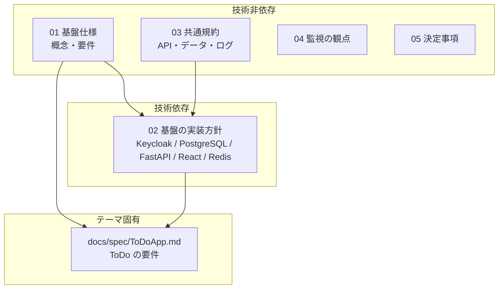

# マルチテナント SaaS 共通基盤 ドキュメント

本ディレクトリは、テーマ（ToDo 等）に依存しない **マルチテナント SaaS の共通基盤** を定義する。
個別テーマの SaaS は、この基盤の上に「ドメイン固有の要件」だけを追加して構築する。

> 参考: オライリー『マルチテナントSaaSアーキテクチャの構築』

## 文書の層構造

技術選定が変わっても読み直す範囲が小さくなるよう、**技術非依存（概念・要件）** と **技術依存（実装方針）** を分けている。

| 文書 | 層 | 内容 |
| --- | --- | --- |
| [01-platform-concepts.md](01-platform-concepts.md) | 技術非依存 | プレーン分離、テナント識別・ライフサイクル、認証・認可モデル、データ分離、共通機能要件、テーマが定義すべき拡張点 |
| [02-platform-implementation.md](02-platform-implementation.md) | 技術依存 | 01 を本リポジトリの技術スタックでどう実現するか（コンテナ、Keycloak、DB ロール、RLS、ディレクトリ構成、開発用ログイン） |
| [03-conventions.md](03-conventions.md) | 技術非依存（実装注記あり） | エラー形式、ページネーション、ID、日時、論理削除、楽観ロック、ログ、監査、命名 |
| [04-observability.md](04-observability.md) | 技術非依存（実装は対象外） | システム監視の観点。現フェーズでは実装しないが、設計時に考慮する |
| [05-decisions.md](05-decisions.md) | 技術非依存 | 共通基盤の決定事項と、将来の方針検討事項 |

## 読み方

- 新しいテーマの SaaS を作る: 01 → 03 → テーマの仕様書を 01 の「テーマが定義すべき事項」に沿って書く
- 実装する: 02 と 03 を正とし、コーディング規約は `docs/coding-standards/` を参照する
- 技術スタックを変える: 02 を差し替え、01・03 は原則として変えない

## 関連

- コーディング規約: `docs/coding-standards/`
- 手順（スキル）: `.github/skills/`
  - `tenant-isolation`: テナントスコープのテーブル・RLS・テナントコンテキスト・クロステナントテスト
  - `tenant-provisioning`: Keycloak のレルム作成とテナント払い出し
  - `db-migration`: Alembic（CP / AP の 2 環境）
  - `run-checks` / `dev-environment`: 検証と開発環境
